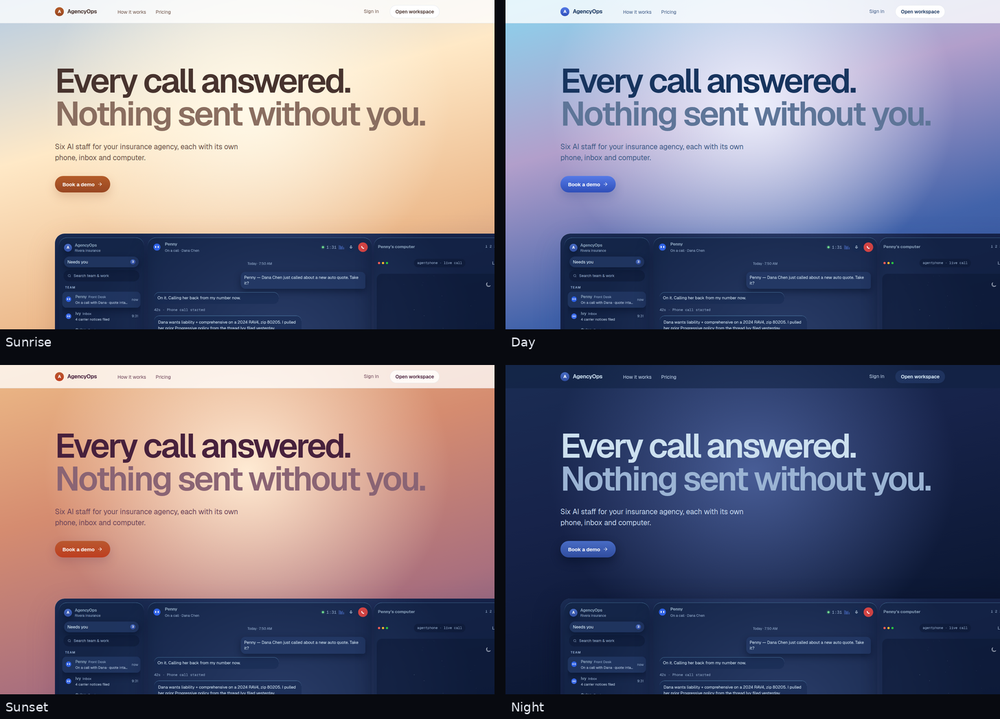
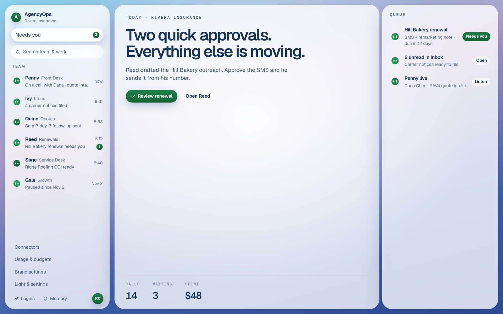
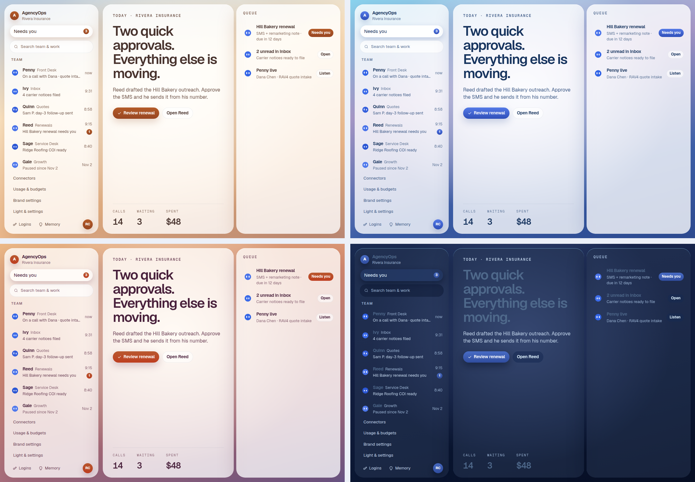
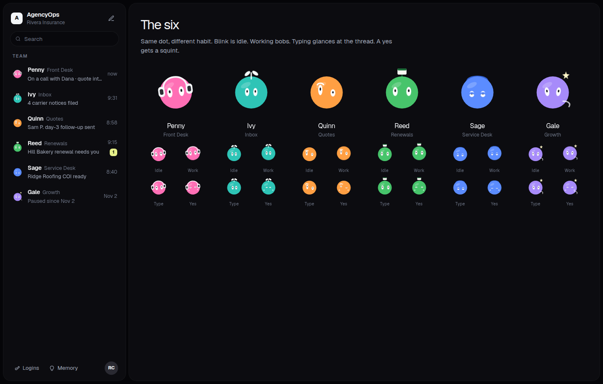
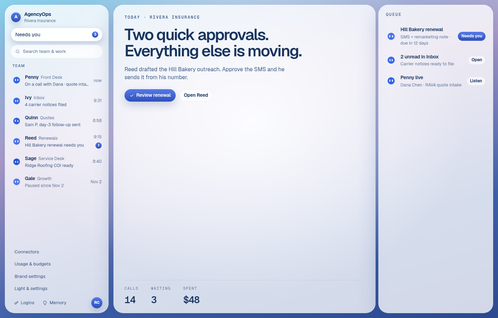
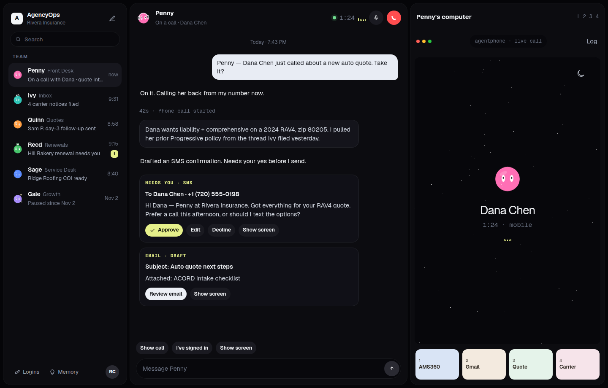
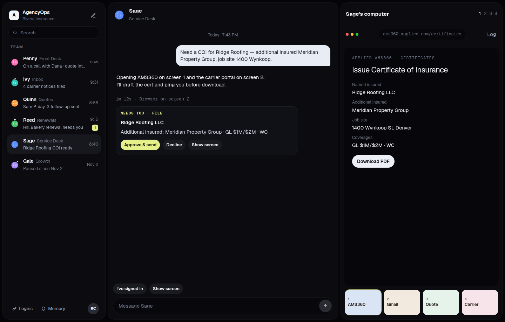
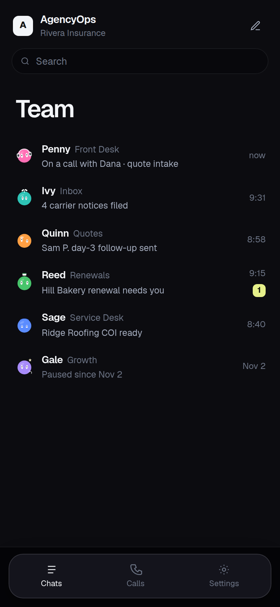
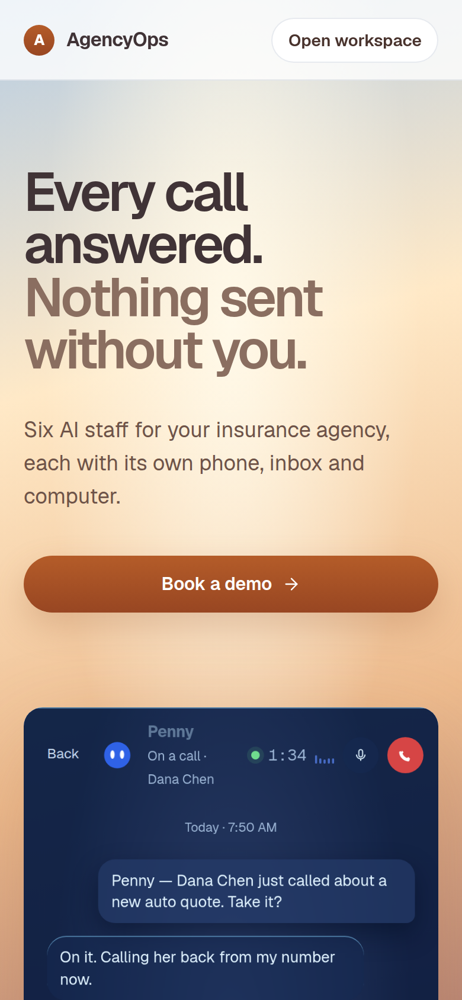

# AgencyOps

AI staff for an independent insurance agency. Six bots share one night desk: a sidebar of people, a chat for each, and that bot's computer. Nothing a customer would receive goes out until a person at the agency approves it. Bots never give coverage advice and never bind a policy.

This repository is an open-source showcase of the kind of desk [Charles Connelly](#custom-version) builds for a client. The workspace you get from the seed is fictional: **Rivera Insurance**. It is not a real agency, and the phone numbers are 555 numbers.

Licensed under the MIT license. Copyright 2026 Charles Connelly. See [LICENSE](LICENSE).

The public page and the desk share one frosted-glass field. It follows the local clock: sunrise, day, sunset, and night, crossfading for 45 minutes. Pick Auto, Sunrise, Day, Sunset, or Night in Settings, or preview with `?tod=sunset`.

Buttons, pills, focus rings, and the agent circles use the agency accent. The stock yellow follows the time of day. A custom brand color takes over, and **Accent follows time of day** on the brand page hands those colors back to the clock. If a brand color would fail contrast on a theme, its lightness shifts for that theme only.









## Download for Windows

[](https://github.com/CharlesBuildsAI/Agencyops/releases/download/v0.1.0/AgencyOps-Setup-0.1.0.exe)

Windows 10 or 11. The installer runs offline in demo mode: no API keys, and the Rivera login works out of the box. The same release is listed at [v0.1.0](https://github.com/CharlesBuildsAI/Agencyops/releases/tag/v0.1.0).

The installer is unsigned. On the SmartScreen prompt, click **More info**, then **Run anyway**.

## What you can click through

| | |
|---|---|
| Home |  |
| Chat, with a text waiting for approval |  |
| Certificate approval and Sage's computer |  |
| Phone on a small screen |  |
| Marketing on a phone |  |

Penny (front desk), Ivy (inbox), Quinn (quotes), Reed (renewals), Sage (service desk), and Gale (growth) are the seeded team. Each face is a flat circle with white pill eyes. On the stock accent they stay blue. A brand color tints the whole team. They blink, bob on a live call, glance while you type, and squint when a draft is approved.

## Features

- One agency, many bots. Each bot has a role prompt, memory notes you can edit, channels, and a monthly spend cap.
- Chat with a real model when `ANTHROPIC_API_KEY` or `OPENAI_API_KEY` is set. With no key, a built-in mock answers so the demo still runs.
- Approvals. SMS, email, outbound calls, and certificate files are drafts. Approve, edit, or decline. The audit log records the decision.
- Budgets. Per-bot and workspace caps. Hitting a cap is a hard stop.
- A computer pane for what the bot is doing. A virtual desktop can plug in later. v1 draws the activity locally.
- Connectors for Gmail, calendar, Slack, AMS360, HawkSoft, and Composio. They are stubs until you add keys.
- Brand settings (name, mark, accent) and a layout that works on a phone.
- Sign-in for an owner, plus staff invites.

## Mock-mode quickstart

No API keys. The default channel mode never dials or sends.

```bash
npm install
cp .env.example .env
npx prisma migrate deploy
npm run db:seed
npm run dev
```

Open http://127.0.0.1:43123

**Demo only.** These credentials are published in this repo. They are not a private password.

- Owner: `rosa@rivera.insurance` / `rivera-demo`
- Staff invite: `/invite/staff-demo-token`

Production (`NODE_ENV=production`) rejects that login, that invite token, and `npm run db:seed` unless you set `DEMO_MODE=true`. Use that flag only if this deploy is the public showcase. For a private install, seed once with `DEMO_MODE=true`, change the owner's password, then unset `DEMO_MODE`. The published password stops working. A different password on that account still works.

The home desk opens on Reed's Hill Bakery renewal. Penny is on a live intake with Dana Chen and has a text waiting. Replay it from the **RC** menu: **Replay Dana's call**.

Simulate another inbound (local default secret is `demo`):

```bash
curl -s -X POST http://127.0.0.1:43123/api/webhooks/inbound \
  -H "content-type: application/json" \
  -H "x-agencyops-secret: demo" \
  -d '{"agencySlug":"rivera","channel":"call","to":"+13035550142","from":"+17205550198","contactName":"Dana Chen","body":"Hi, I need a quote on a 2024 RAV4, zip 80205."}'
```

## Environment

Copy `.env.example`. Every key is listed there.

| Variable | Purpose |
|---|---|
| `DATABASE_URL` | SQLite file locally (`file:./dev.db`). Use a persistent disk or Postgres in production. |
| `AUTH_SECRET` | Signs the session cookie. In production this must be a unique value from the environment, at least 24 characters. Placeholders are rejected. There is no production fallback. |
| `DEMO_MODE` | `true` allows the published demo login, invite, seed, and the webhook secret `demo` in production. Leave empty for a client deploy. |
| `APP_URL` | Public URL, used for invite links. |
| `LLM_PROVIDER` | `auto` (default), `anthropic`, `openai`, or `mock`. |
| `ANTHROPIC_API_KEY`, `ANTHROPIC_MODEL` | Optional. `auto` uses Anthropic when this key is set. |
| `OPENAI_API_KEY`, `OPENAI_MODEL` | Optional. Used when Anthropic is unset. |
| `CHANNEL_MODE` | `mock` (default) or `live`. |
| `TWILIO_ACCOUNT_SID`, `TWILIO_AUTH_TOKEN`, `TWILIO_FROM_NUMBER` | Live SMS after approval. |
| `AGENTMAIL_API_KEY`, `AGENTMAIL_INBOX_ID` | Live email after approval. |
| `AGENTPHONE_API_KEY`, `AGENTPHONE_BASE_URL` | Optional phone adapter. |
| `DEMO_WEBHOOK_SECRET` | Inbound webhook. The local value `demo` is rejected in production unless `DEMO_MODE=true`. |
| `COMPUTER_PROVIDER` | `stub` or `orgo`. v1 always draws the local desktop. |
| `HAWKSOFT_API_KEY`, `HAWKSOFT_AGENCY_ID`, `AMS360_APP_KEY`, `COMPOSIO_API_KEY` | Connector stubs. Blank stays in sandbox. |

## Windows app

The desktop app is the same desk in its own window, titled AgencyOps, with the blue agent icon. It installs on Windows and runs offline in mock mode: no API keys, the Rivera demo login, and the same glass themes. Building it does not change the web app or its deploy.

```bash
npm run desktop:dev
```

That opens a window onto the dev server at http://127.0.0.1:43123 (and starts the server if it is not already up).

```bash
npm run desktop:build
```

The installer is written to `desktop/release/AgencyOps-Setup-0.1.0.exe`. Run it, then launch AgencyOps from the desktop shortcut. Sign in with `rosa@rivera.insurance` / `rivera-demo`.

The installer is unsigned. Windows SmartScreen warns that an unrecognized app is trying to start. Choose **More info**, then **Run anyway**.

A Windows installer built on Linux needs Wine, which `electron-builder` uses to run NSIS.

## Deploy

The SQLite file has to live on a persistent disk. Vercel serverless will not keep it. Fly and Render will, if you attach a volume. You can also switch the Prisma datasource to Postgres and run a migration.

Do not set `DEMO_MODE` on a client deployment you do not want strangers to sign into with the password in this README.

### Fly

`Dockerfile` and `fly.toml` are included. Create a volume at `/data`.

```bash
fly secrets set \
  AUTH_SECRET="$(openssl rand -base64 32)" \
  DATABASE_URL="file:/data/agencyops.db" \
  APP_URL="https://your-app.fly.dev" \
  DEMO_WEBHOOK_SECRET="$(openssl rand -base64 32)"
fly deploy
```

To load the showcase data on that machine:

```bash
fly ssh console -C "NODE_ENV=production DEMO_MODE=true npx tsx prisma/seed.ts"
```

Then change the owner password and remove `DEMO_MODE` if the published password should stop working.

### Render

Web service, Node, disk mounted at `/data`.

- Build: `npm install && npx prisma generate && npm run build`
- Start: `npx prisma migrate deploy && npm run start`
- `DATABASE_URL=file:/data/agencyops.db`
- `AUTH_SECRET` from the environment, not the example file
- Render sets `PORT`. The start script listens on it.

## Checks

```bash
npm test
npm run typecheck
npm run lint
```

Tests cover the approval gate, the budget cap, the production lock on the demo login, and accent contrast on every theme.

## Custom version

AgencyOps is the showcase. Charles Connelly builds a branded desk like this for one business: their name, their bots, their approvals.

Email [lovelandseeker@gmail.com](mailto:lovelandseeker@gmail.com).

## Project notes

Original code. It does not include Orgo, BOPS, or any other agent platform's source.

Contributing: [CONTRIBUTING.md](CONTRIBUTING.md). Security: [SECURITY.md](SECURITY.md).
